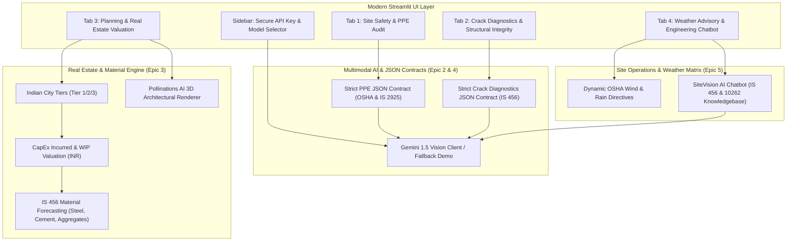

# 🏗️ Multimodal Construction Intelligence Platform
### Skill Wallet Capstone Project 1 • Generative AI & Real Estate Decision Support
**Platform ID:** `6ac4c98d1dcde6d7857c1642`  
**Deployment Profile:** Streamlit Community Cloud (Zero external database dependencies)

---

## 📌 Executive Summary & Scope
The **Multimodal Construction Intelligence Platform** is an enterprise-grade AI decision-support system designed for civil contractors, site safety managers, structural auditors, and real estate developers. It unites cutting-edge multimodal vision models (**Google Gemini 1.5 Flash / Pro**), strict JSON data contracts, and Indian Standard civil codes (**IS 456:2000, IS 10262, IS 13920, OSHA 1926**) into an interactive decision-support dashboard.

---

## 🎯 Kanban Epics & Architecture



---

## 🚀 Key Functional Modules

### 1. Site Safety & PPE Audit (Epic 2 & 4)
- **Computer Vision Auditing:** Detects compliance across 4 mandatory personal protective gear categories:
  - **Safety Helmets / Hard Hats:** IS 2925 / OSHA 1926.100
  - **High-Visibility Reflective Vests:** IS 15809 / OSHA 1926.201
  - **Steel-Toe Footwear:** IS 15298 / OSHA 1926.96
  - **Full-Body Safety Harnesses:** IS 3521 / OSHA 1926.502
- **Structured JSON Contract Output:** Computes `safety_score` (0-100), `overall_status`, compliance checklist, and site hazards categorized by severity (`Critical`, `High`, `Medium`, `Low`) with step-by-step corrective remedies.
- **Pre-Loaded Benchmarks:** 1-click testable compliant and non-compliant site photos.
- **Downloadable Reports:** 1-click JSON export.

### 2. Forensic Crack Diagnostics & Structural Integrity (Epic 2 & 4)
- **Defect Classification:** Categorizes concrete pathologies into:
  - *Structural Shear* (45° diagonal tension failure across beams/columns)
  - *Hairline Plaster Shrinkage* (<0.4 mm non-structural)
  - *Settlement Cracking* (differential foundation movement)
  - *Thermal Expansion Joints*
  - *Spalling & Rebar Corrosion* (carbonation and chloride-induced cover failure)
- **Quantitative Metrics:** Estimates aperture width in millimeters, assess depth penetration, and cites compliance with **IS 456:2000 Clause 35.3.2 & 40**.
- **Engineering Repair Protocols:** Generates tailored specifications for:
  - Low-viscosity epoxy resin pressure injection (e.g., Sikadur-52 / Nitokit LV)
  - Polymer micro-concrete structural re-grouting
  - External Carbon Fiber Reinforced Polymer (CFRP) wrapping
  - Unit repair cost estimates in INR.

### 3. Planning & Real Estate Valuation Engine (Epic 3)
- **Dynamic Econometric Modeling in INR:**
  - Structure types: Residential Apartment (G+14), Grade-A Commercial Office, Industrial PEB Warehouse, Luxury Villa, Mixed-Use.
  - Indian City Tiers: Tier 1 Metros (Mumbai, Delhi-NCR, Bengaluru), Tier 2 Urban Hubs (Pune, Ahmedabad, Jaipur), Tier 3 Districts.
  - Real estate outputs formatted in **Crores (₹ Cr)** and **Lakhs (₹ L)**:
    - *Total Project Budget*
    - *CapEx Incurred to Date*
    - *Current Work-in-Progress (WIP) Market Asset Valuation*
    - *Projected Ready Market Value*
- **Material Consumption Forecasting (IS 456 Thumb Rules):**
  - Cement bags and Metric Tons (50 kg bags)
  - TMT Rebar Steel in Metric Tons (Fe500D)
  - Coarse Sand / M-Sand in Brass (1 Brass = 100 cu.ft)
  - Coarse Aggregates (10mm/20mm) in Brass
- **Milestone Progress Bar:** Interactive 7-stage construction schedule (Excavation, Substructure, Superstructure, Masonry, MEP, Finishing, Handover).
- **Conceptual 3D Architectural Rendering:** Instant generative 3D visual concepts via **Pollinations AI** with customizable architectural styles (Biophilic, Parametric Glass, Indian Contemporary, Industrial Precast) and lighting atmospheres.

### 4. Daily Site Assistant & Weather-Aware Advisory (Epic 5)
- **Dynamic Weather Protocols:**
  - *High Wind (>35 km/h):* Mandatory tower crane suspension (OSHA 1926.1431), suspended cradle evacuation, plastic shrinkage protection.
  - *Heavy Rain / Monsoon:* Excavation shoring protection (IS 3764), 30mA ELCB electrical protection, concrete wash-out prevention.
  - *Extreme Heat (>40°C):* Hot weather concreting under **IS 7861 Part 1**, chilled mixing water, continuous 14-day wet burlap curing.
  - *Normal:* Routine daily toolbox sweeps and rebar cover inspections.
- **SiteVision AI Engineering Chatbot:**
  - Multi-turn conversation maintaining full session history.
  - Answers complex technical inquiries regarding formwork stripping schedules (IS 456 Table 11), nominal rebar covers, concrete grade mix ratios (M20 to M40), and OSHA fall arrest regulations.
  - Includes quick 1-click preset prompt chips.

---

## 💻 Installation & Quickstart

### 1. Clone or Open Workspace
```bash
cd "skill wallet"
```

### 2. Launch Streamlit Application
```bash
streamlit run app.py
```
Open your browser at `http://localhost:8501`.

### 3. Demonstration Mode vs Live Gemini API
- **Demo Mode (Default):** Leave the API key field blank in the sidebar. The platform functions 100% offline with zero dependencies using domain-authentic civil engineering benchmarks.
- **Live Multimodal Mode:** Enter your Google Gemini API Key (`AIzaSy...`) in the sidebar to run live vision inference on your custom uploaded site photos.

---

## 📦 File Structure

```
skill wallet/
├── app.py                          # Main Streamlit web application & modern CSS layout
├── config.py                       # Indian city tiers, structure costs, IS 456 standards
├── requirements.txt                # Deployment dependencies
├── .env.example                    # Template environment variables
├── generate_sample_assets.py       # High-fidelity benchmark image generator
├── README.md                       # Comprehensive Capstone documentation
├── modules/
│   ├── __init__.py
│   ├── gemini_client.py            # Multimodal Gemini 1.5 client & fallback engine
│   ├── ppe_audit.py                # PPE compliance engine & structured JSON contract
│   ├── crack_diagnostics.py        # Concrete crack forensics & repair protocols
│   ├── valuation.py                # INR cost estimation, CapEx & material calculations
│   ├── pollinations_client.py      # Conceptual 3D architectural rendering integration
│   ├── weather_advisory.py         # Weather risk matrix & dynamic alerts
│   └── chatbot.py                  # SiteVision AI engineering assistant chatbot
└── assets/
    ├── sample_ppe_compliant.jpg    # Benchmark compliant site photo
    ├── sample_ppe_violation.jpg    # Benchmark hazard violation photo
    ├── sample_crack_shear.jpg      # Benchmark 45° diagonal shear crack photo
    └── sample_crack_hairline.jpg   # Benchmark hairline shrinkage crack photo
```

---

## ☁️ 1-Click Streamlit Community Cloud Deployment
1. Push this directory to your GitHub repository.
2. Visit [share.streamlit.io](https://share.streamlit.io).
3. Select your repository, branch (`main`), and set the main file path to `app.py`.
4. (Optional) In Advanced Settings, add `GEMINI_API_KEY` under Secrets.
5. Click **Deploy!** Zero external databases or Docker containers required.
